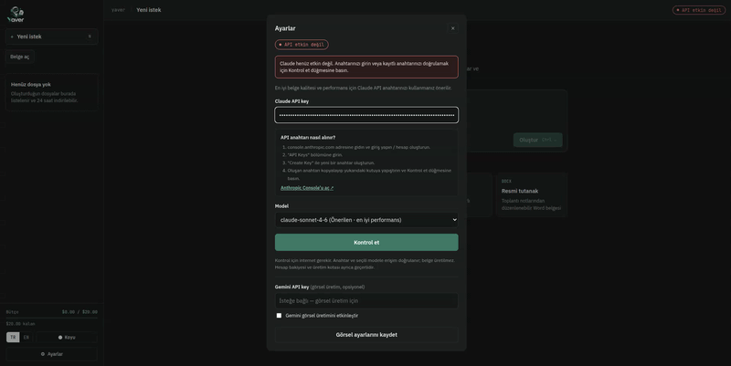

# Office Manipulator — Kurulum (internetsiz ortam)

Bu, Office Manipulator'ın internet bağlantısı olmayan bir bilgisayarda çalıştırılması için hazırlanmış teslim paketidir. Dosya yükleme/indirme, belge önizleme, biçim dönüştürme (ör. Word → PDF) ve ONLYOFFICE ile tarayıcı içi belge düzenleme **tamamen yerel** çalışır — internet gerekmez. AI (Claude sohbeti, AI ile belge üretimi, Yaver'in yazım önerileri) isteğe bağlıdır ve yalnızca internet varsa kullanılabilir; API anahtarı girilmediği sürece bu özellikler kapalı kalır, geri kalan her şey etkilenmeden çalışır.

## Ekran görüntüleri

| Ana sayfa | AI ayarları |
|---|---|
|  |  |

## Gereksinimler

Hedef bilgisayarda yalnızca şunlar kurulu olmalı:

- **Docker Engine** ve **Docker Compose v2**
- Docker servisi çalışır durumda olmalı

Java, Maven, Node.js, npm gibi hiçbir geliştirme aracının kurulu olması gerekmez; hepsi size verilen imajların içindedir.

## Kurulum

Size verilen paket şu dosyaları içermelidir: `app.tar`, `postgres.tar`, `onlyoffice.tar` (hazır Docker imajları), `docker-compose.yml`, `baslat.sh`, `durdur.sh` ve bu `README.md`.

**1) Yapılandırmayı hazırlayın** (bu klasörde `.env` yoksa):

```bash
cp .env.example .env
openssl rand -hex 32
```

Yukarıdaki komutun çıktısını `.env` dosyasında `OFFICE_JWT_SECRET=...` satırına yazın. `DB_PASSWORD=changeme` satırını da kendi belirleyeceğiniz bir parolayla değiştirin. `ANTHROPIC_API_KEY` satırını **boş bırakın** (AI özelliği kapalı kalır; dosya yönetimi ve ONLYOFFICE düzenleme bundan etkilenmez). `.env` dosyasını güvenli bir yerde saklayın, kimseyle paylaşmayın. (Size zaten doldurulmuş bir `.env` verildiyse bu adımı atlayın.)

**2) Başlatın:**

```bash
bash baslat.sh
```

Betik sırasıyla: Docker'ın kurulu/çalışır olduğunu, `.env`'in doldurulduğunu kontrol eder → imajları yükler → yapılandırmayı doğrular → servisleri başlatıp sağlıklı olmalarını bekler. İlk açılış birkaç dakika sürebilir. Sorun olursa betik size hangi komutla (`docker compose ... logs`) inceleyeceğinizi gösterir.

Durdurmak için: `bash durdur.sh` (veritabanı ve dosyalar korunur; `bash baslat.sh` ile kaldığı yerden devam eder).

> Betik olmadan elle başlatmak isterseniz: `docker load -i app.tar && docker load -i postgres.tar && docker load -i onlyoffice.tar && docker compose up -d --no-build --pull never && docker compose ps`.

**3) Tarayıcıdan açın:**

- Uygulama: **http://localhost:8081**
- ONLYOFFICE (uygulama tarafından otomatik kullanılır, doğrudan açmanız gerekmez): **http://localhost:8082**

Her iki adres de yalnızca bu bilgisayardan (`localhost`) erişilebilir; ağdaki başka bir cihazdan erişilemez.

## Doğrulama

```bash
docker compose -p office-manipulator-teslim ps
curl -s http://localhost:8081/api/office/capabilities
```

İkinci komut bir JSON yanıtı dönerse uygulama ve ONLYOFFICE entegrasyonu çalışıyor demektir.

## Durdurma ve yeniden başlatma

```bash
bash durdur.sh    # servisleri durdurur, veritabanı/dosyalar korunur
bash baslat.sh    # kaldığı yerden yeniden başlatır
```

Günlükleri incelemek için:

```bash
docker compose -p office-manipulator-teslim logs --tail=100
docker compose -p office-manipulator-teslim logs -f app   # yalnızca uygulama servisini canlı izlemek için
```

> `-p office-manipulator-teslim` bayrağı önemli: bu klasörün adı farklıysa Docker Compose proje adını klasör adından türetir ve `baslat.sh`'ın kullandığı sabit proje adıyla eşleşmeyebilir. `-p office-manipulator-teslim` yazmayı unutursanız komut "boş" görünebilir.

## Ortam değişkenleri (`.env`)

| Değişken | Açıklama | Ne yapmalısınız |
|---|---|---|
| `DB_PASSWORD` | PostgreSQL parolası | **Zorunlu** — kendi parolanızı belirleyin |
| `OFFICE_JWT_SECRET` | ONLYOFFICE ↔ uygulama imzalama anahtarı | **Zorunlu** — `openssl rand -hex 32` ile üretin |
| `ANTHROPIC_API_KEY` | Claude API anahtarı | Boş bırakın — AI özellikleri kapalı kalır. İleride internet erişimi olan bir ortamda kullanmak isterseniz arayüzün **Ayarlar** bölümünden de girip doğrulayabilirsiniz, `.env`'e yazmak zorunlu değildir |
| `ANTHROPIC_BASE_URL` | Anthropic API uç noktası | Boş bırakın (resmî adres kullanılır) — yalnızca kendi barındırdığınız bir Claude-uyumlu uç nokta kullanacaksanız doldurun |
| `FILE_TTL_HOURS` | Üretilen/yüklenen dosyaların ne kadar süre saklanacağı | Varsayılan `72` (saat); ihtiyaca göre değiştirebilirsiniz |
| `BUDGET_LIMIT_USD` | AI çağrıları için bütçe tavanı | AI kapalıyken etkisizdir, değiştirmenize gerek yok |
| `GEMINI_API_KEY`, `GEMINI_ENABLED` | Opsiyonel AI görsel üretimi | Boş/`false` bırakın |

Diğer satırlar (`CLAUDE_MODEL`, fiyat alanları vb.) AI kapalıyken etkisizdir; dokunmanıza gerek yoktur.

## Sınırlamalar

- AI özellikleri (sohbet, AI ile belge/sunum üretimi, Yaver'in önerileri) internet gerektirir ve `ANTHROPIC_API_KEY` boşken kapalıdır — bu beklenen bir durumdur, hata değildir.
- Dosya yükleme/indirme, önizleme, biçim dönüştürme ve ONLYOFFICE ile belge düzenleme internet olmadan da tam çalışır.
- Port `8081` veya `8082` başka bir uygulama/konteyner tarafından kullanılıyorsa, `docker-compose.yml` içindeki ilgili `ports:` satırını (örn. `127.0.0.1:8081:8080`) değiştirip `bash baslat.sh`'ı tekrar çalıştırın.

## Sorun giderme

- `bash baslat.sh` "port is already allocated" hatası verirse: önce bu bilgisayarda başka bir Docker Compose projesinin aynı portu kullanmadığından emin olun — `docker ps --format "table {{.Names}}\t{{.Ports}}"` ile tüm çalışan konteynerleri listeleyip 8081/8082'yi kimin tuttuğunu görün. Eski/yarım kalmış bir proje varsa `docker compose -p <proje-adı> down` ile kapatın.
- Hata devam ediyor ama `docker ps` hiçbir şeyin o portu kullanmadığını gösteriyorsa: Docker'ın kendi port kayıt tablosu bozulmuş olabilir (özellikle bir konteyner zorla sonlandırıldıysa). `sudo systemctl restart docker` ile Docker servisini yeniden başlatmak genelde bunu çözer — bu, bu bilgisayardaki diğer tüm konteynerleri de kısaca durdurup (varsa) yeniden başlatır.
- `docker compose -p office-manipulator-teslim ps` çıktısında bir servis `unhealthy`/`exited` görünüyorsa: `docker compose -p office-manipulator-teslim logs <servis-adı>` ile ayrıntıyı inceleyin.
- `.env` dosyasında `DB_PASSWORD` veya `OFFICE_JWT_SECRET` boşsa `baslat.sh` bunu başlamadan önce fark edip net bir hata mesajıyla durur — ilgili alanı doldurup tekrar deneyin.
- Docker soketine erişim izni hatası alırsanız komutları `sudo` ile çalıştırmayı deneyin veya kullanıcınızı `docker` grubuna ekleyin.

---

Bu paketi hazırlayan/güncelleyen kişi için mimari, paketleme adımları ve test kaydı dahil kapsamlı dokümantasyon: **[docs/paketleme-ve-teslim.md](docs/paketleme-ve-teslim.md)**.
