# Office Manipulator — Kurulum (internetsiz ortam)

Bu, Office Manipulator'ın internet bağlantısı olmayan bir bilgisayarda çalıştırılması için hazırlanmış teslim paketidir. Dosya yükleme/indirme, belge önizleme, biçim dönüştürme (ör. Word → PDF) ve ONLYOFFICE ile tarayıcı içi belge düzenleme **tamamen yerel** çalışır — internet gerekmez. AI (sohbet, AI ile belge üretimi, Yaver'in yazım önerileri; Claude, Gemini veya GPT ile) isteğe bağlıdır ve yalnızca internet varsa kullanılabilir; API anahtarı girilmediği sürece bu özellikler kapalı kalır, geri kalan her şey etkilenmeden çalışır.

## Ekran görüntüleri

| Ana sayfa | AI ayarları |
|---|---|
| 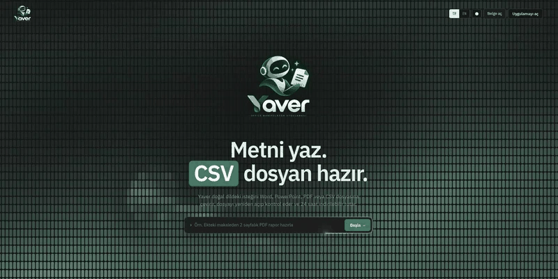 | 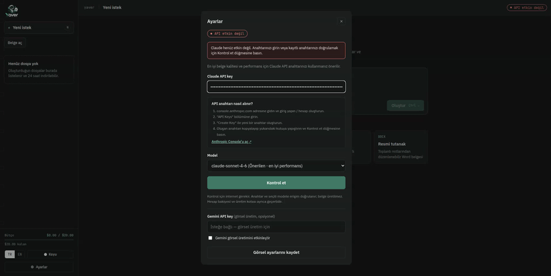 |

| PPTX oluşturma | Plan onaylama |
|---|---|
| 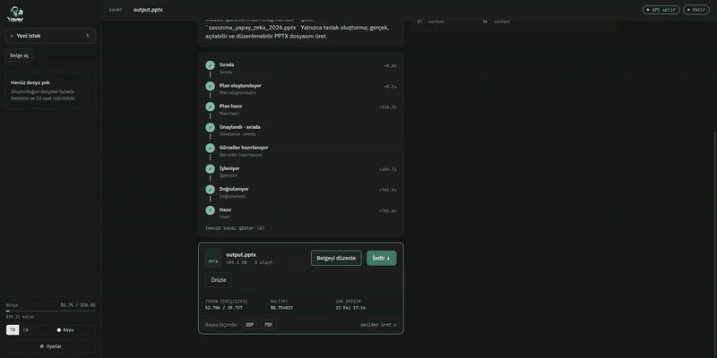 | 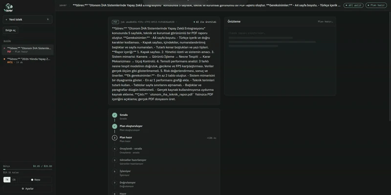 |

| PDF çıktısı (ONLYOFFICE) | CSV oluşturma |
|---|---|
| 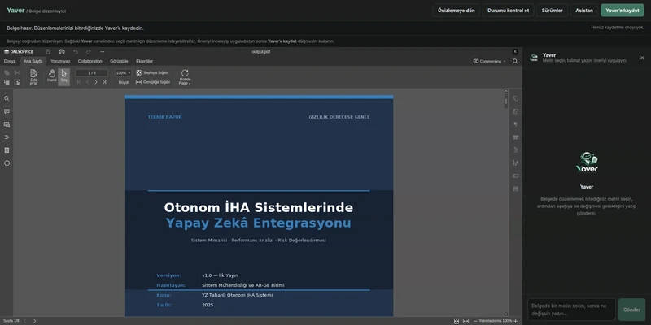 | 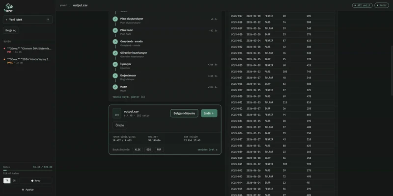 |

| DOCX düzenleme (ONLYOFFICE) |
|---|
| 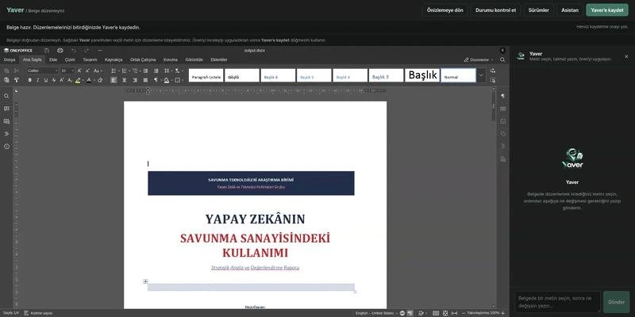 |

## Yeni özellikler

| Üç yapay zekâ sağlayıcısı: Anthropic, Gemini, OpenAI | Bilgi kartları ve kullanım rehberi |
|---|---|
| 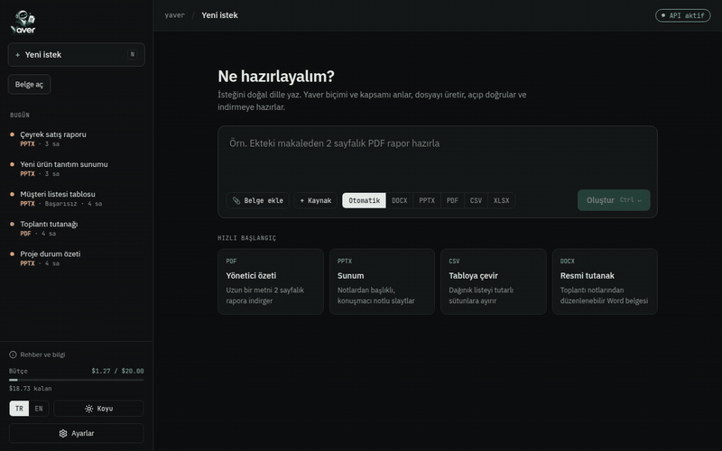 | 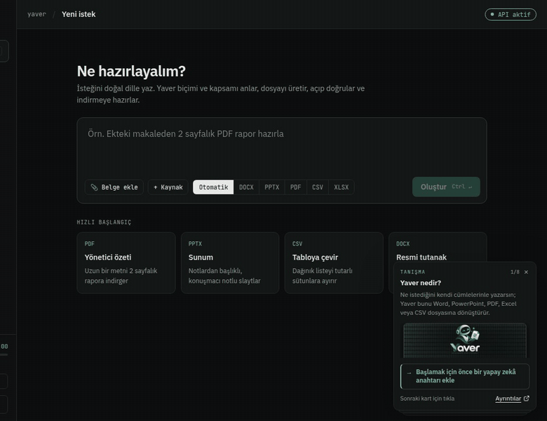 |
| Ayarlar'da sağlayıcı seçilir, kendi API anahtarı girilip doğrulanır; model listeden seçilir ya da "Diğer (elle gir)" ile yazılır. Ayarlar dikey sekmeli: Yapay zekâ, Görsel üretim, Görünüm. | Sağ altta, tıklayınca sıradakine geçen 8 kartlık deste: Yaver nedir, API anahtarı, istek yazma, plan ve üretim, düzenleme, model seçimi, maliyet, API entegrasyonu. Her kartta bir yönlendirme düğmesi; üzerine gelince ekran görüntüleri yelpaze gibi açılır. |

| Görsel incelemeli sunum üretimi | Yaver Agent sohbet paneli |
|---|---|
|  | 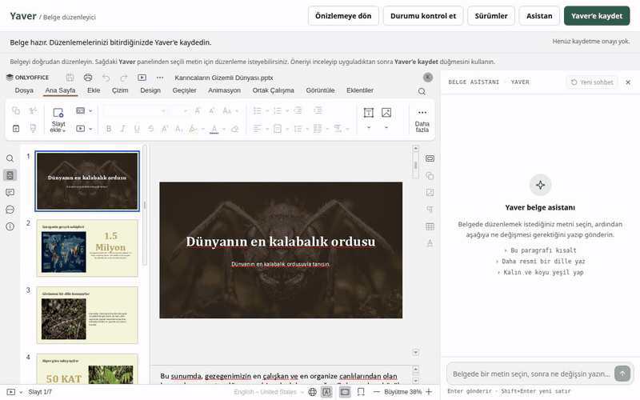 |
| Sunumlar tasarım rehberleriyle üretilir, slaytlar görüntüye çevrilip yapay zekâya gösterilir ve taşan yazı, boş alan, okunmayan renk gibi kusurlar düzeltilir; en az kusurlu sürüm teslim edilir. Gemini anahtarıyla slaytlara görsel üretilir; fontlar konuya göre hazır eşleştirmelerden seçilir. Dosya adları içerikten türetilir. | Editördeki asistan mesaj akışı biçiminde: istek balonları, "N sn'de hazırladı" özeti, HAZIR / UYGULANDI durum çipleri ve açılabilir değişiklik farkı. |

| Animasyonlu tema geçişi |
|---|
| 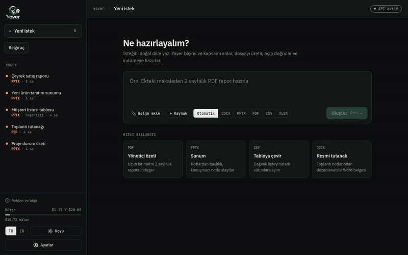 |
| Açık/koyu tema düğmeden yayılan bir daire ile değişir; açık temada logo da açık tema sürümüne geçer. |

### Kendi anahtarınızla API çağrısı

Kullanıcıya dönük eşzamanlı uç noktalar (`POST /api/chat`, belge düzenleme, Yaver Agent) istek gövdesinde isteğe bağlı `llm_provider`, `llm_api_key`, `llm_model` alanlarını kabul eder; o istek `.env`'deki varsayılan yerine bu anahtarla çalışır ve anahtar saklanmaz. Arka plan ve zamanlanmış işler her zaman `.env` değerlerini kullanır. Sağlayıcı yalnızca `anthropic`, `gemini` veya `openai` olabilir; istekten adres/uç nokta kabul edilmez.

```bash
curl -X POST http://localhost:8081/api/chat \
  -H "Authorization: Bearer $YAVER_API_KEY" \
  -H 'Content-Type: application/json' \
  -d '{"message": "<isteğiniz>", "format": "DOCX", "llm_provider": "gemini", "llm_api_key": "<anahtarınız>", "llm_model": "gemini-2.5-pro"}'
```

## API ile kullanım

Docker ayağa kalktığında uygulama **yalnızca bir API servisi** olarak çalışır: web arayüzü sunulmaz, sitede yapılabilen her şey (belge üretme, plan onaylama, düzenleme, dönüştürme, indirme, ayarlar) HTTP API ile yapılır. Böylece başka uygulamalar Yaver'e doğrudan bağlanabilir.

**Kimlik doğrulama:** Her `/api/...` isteği `.env`'deki `YAVER_API_KEYS` anahtarlarından birini taşımalıdır:

```
Authorization: Bearer <anahtar>      # ya da
X-API-Key: <anahtar>
```

Anahtar yoksa ya da yanlışsa yanıt `401` olur. Birden çok anahtarı virgülle ayırarak her bağlanan uygulamaya ayrı anahtar verebilir, birini silerek erişimini kesebilirsiniz.

**Açık (anahtarsız) adresler:**
- `GET /health`: sağlık kontrolü (`{"status":"UP"}`)
- `GET /docs`: Swagger arayüzü; tüm uç noktalar burada denenebilir (sağ üstteki **Authorize** düğmesine anahtarı girin)
- `GET /v3/api-docs`: OpenAPI 3 şeması; istemci kodu üretmek için kullanılabilir

**Tipik akış:**

```bash
B=http://<sunucu>:8081; H="Authorization: Bearer $YAVER_API_KEY"

# 1) LLM anahtarını bir kez kaydedip doğrulayın (ya da .env'e yazın, ya da her istekte llm_api_key gönderin)
curl -X POST $B/api/settings/verify -H "$H" -H 'Content-Type: application/json' \
  -d '{"provider":"gemini","claudeApiKey":"<LLM anahtarı>","model":"gemini-2.5-pro"}'

# 2) İş oluşturun → {"jobId":"…","status":"PENDING"}
curl -X POST $B/api/chat -H "$H" -H 'Content-Type: application/json' \
  -d '{"message":"3 ürün ve fiyatlarından oluşan bir tablo","format":"XLSX"}'

# 3) Durum PLAN_READY olunca planı görün ve onaylayın
curl -H "$H" $B/api/jobs/<jobId>            # status alanını izleyin
curl -H "$H" $B/api/jobs/<jobId>/plan
curl -X POST -H "$H" -H 'Content-Type: application/json' -d '{}' $B/api/jobs/<jobId>/plan/confirm

# 4) İlerlemeyi canlı izleyin (Server-Sent Events) ve DONE olunca indirin
curl -N -H "$H" $B/api/jobs/<jobId>/events
curl -H "$H" -OJ $B/api/files/<jobId>/download
```

**Başlıca uç noktalar** (tam liste ve şemalar `/docs`'ta):

| Uç nokta | İş |
|---|---|
| `POST /api/chat` | Metin isteğinden belge işi oluşturur (`format`: DOCX, PPTX, XLSX, PDF, CSV, …) |
| `POST /api/chat/with-file` | Dosya yükleyerek iş oluşturur (multipart: `message`, `file`) |
| `GET /api/jobs`, `GET /api/jobs/{id}` | İş listesi / tek iş durumu |
| `GET /api/jobs/{id}/events` | Durum değişikliklerini SSE olarak akıtır |
| `GET /api/jobs/{id}/plan`, `POST …/plan/confirm` | Üretim planını görme / onaylama |
| `POST /api/jobs/{id}/edit`, `…/edit-fragment` | Hazır belgeyi doğal dille düzenleme |
| `PATCH /api/jobs/{id}/content` | İçeriği doğrudan güncelleme |
| `POST /api/jobs/{id}/convert`, `…/cancel` | Başka biçime dönüştürme / iptal |
| `GET /api/files/{id}/download`, `…/preview`, `…/preview/images` | İndirme ve önizleme |
| `POST /api/office/import`, `GET\|POST /api/office/text/{jobId}` | Mevcut belgeyi içe aktarma, metnini okuma/yazma |
| `GET\|POST /api/settings`, `POST /api/settings/verify` | LLM sağlayıcı/anahtar ayarları |
| `GET /api/budget` | Harcanan / kalan bütçe |

**Tarayıcıdan çağrı (CORS):** Sunucudan sunucuya çağrılarda bir şey gerekmez. Başka bir alan adındaki web uygulaması tarayıcıdan çağıracaksa o adresi `YAVER_CORS_ORIGINS=https://portal.ornek.com` şeklinde ekleyin; listede olmayan kaynaklardan gelen tarayıcı istekleri `403` alır.

> **Güvenlik:** API anahtarı düz HTTP üzerinden açık metin gider. Uygulamayı internete ya da güvenilmeyen bir ağa açacaksanız önüne HTTPS sonlandıran bir ters vekil (nginx, Caddy, Traefik) koyun ve `.env`'de `API_BIND_ADDRESS=127.0.0.1` yapın. `/internal/...` uç noktaları her durumda yalnızca konteynerin kendisinden erişilebilir.

## Gereksinimler

Hedef bilgisayarda yalnızca şunlar kurulu olmalı:

- **Docker Engine** ve **Docker Compose v2**
- Docker servisi çalışır durumda olmalı

Java, Maven, Node.js, npm gibi hiçbir geliştirme aracının kurulu olması gerekmez; hepsi size verilen imajların içindedir.

## Kurulum

Size verilen paket şu dosyaları içermelidir: `app.tar`, `postgres.tar`, `onlyoffice.tar` (hazır Docker imajları), `docker-compose.yml`, `baslat.sh`, `durdur.sh` ve bu `README.md`.

**1) Yapılandırmayı hazırlayın** (bu klasörde `.env` yoksa):

```bash
cp .env.example .env
openssl rand -hex 32
```

Yukarıdaki komutun çıktısını `.env` dosyasında `OFFICE_JWT_SECRET=...` satırına yazın. `DB_PASSWORD=changeme` satırını da kendi belirleyeceğiniz bir parolayla değiştirin. `YAVER_API_KEYS=` satırına da ikinci bir `openssl rand -hex 32` çıktısı yazın; diğer uygulamalar API'ye bu anahtarla bağlanır. `ANTHROPIC_API_KEY` satırını **boş bırakın** (AI özelliği kapalı kalır; dosya yönetimi ve ONLYOFFICE düzenleme bundan etkilenmez). `.env` dosyasını güvenli bir yerde saklayın, kimseyle paylaşmayın. (Size zaten doldurulmuş bir `.env` verildiyse bu adımı atlayın.)

**2) Başlatın:**

```bash
bash baslat.sh
```

Betik sırasıyla: Docker'ın kurulu/çalışır olduğunu, `.env`'in doldurulduğunu kontrol eder → imajları yükler → yapılandırmayı doğrular → servisleri başlatıp sağlıklı olmalarını bekler. İlk açılış birkaç dakika sürebilir. Sorun olursa betik size hangi komutla (`docker compose ... logs`) inceleyeceğinizi gösterir.

Durdurmak için: `bash durdur.sh` (veritabanı ve dosyalar korunur; `bash baslat.sh` ile kaldığı yerden devam eder).

> Betik olmadan elle başlatmak isterseniz: `docker load -i app.tar && docker load -i postgres.tar && docker load -i onlyoffice.tar && docker compose up -d --no-build --pull never && docker compose ps`.

**3) API'ye bağlanın:**

- API: **http://<sunucu>:8081/api/...** (ayrıntılar: [API ile kullanım](#api-ile-kullanım))
- API dokümantasyonu: **http://<sunucu>:8081/docs**
- ONLYOFFICE (uygulama tarafından otomatik kullanılır, doğrudan açmanız gerekmez): **http://localhost:8082**

API ağdaki diğer cihazlardan anahtarla erişilebilir (`API_BIND_ADDRESS`); ONLYOFFICE yalnızca bu bilgisayardan erişilebilir.

## Doğrulama

```bash
docker compose -p office-manipulator-teslim ps
curl -s http://localhost:8081/health
curl -s -H "Authorization: Bearer <YAVER_API_KEYS'teki anahtar>" http://localhost:8081/api/office/capabilities
```

İkinci komut bir JSON yanıtı dönerse uygulama ve ONLYOFFICE entegrasyonu çalışıyor demektir.

## Durdurma ve yeniden başlatma

```bash
bash durdur.sh    # servisleri durdurur, veritabanı/dosyalar korunur
bash baslat.sh    # kaldığı yerden yeniden başlatır
```

Günlükleri incelemek için:

```bash
docker compose -p office-manipulator-teslim logs --tail=100
docker compose -p office-manipulator-teslim logs -f app   # yalnızca uygulama servisini canlı izlemek için
```

> `-p office-manipulator-teslim` bayrağı önemli: bu klasörün adı farklıysa Docker Compose proje adını klasör adından türetir ve `baslat.sh`'ın kullandığı sabit proje adıyla eşleşmeyebilir. `-p office-manipulator-teslim` yazmayı unutursanız komut "boş" görünebilir.

## Ortam değişkenleri (`.env`)

| Değişken | Açıklama | Ne yapmalısınız |
|---|---|---|
| `DB_PASSWORD` | PostgreSQL parolası | **Zorunlu** — kendi parolanızı belirleyin |
| `YAVER_API_KEYS` | Diğer uygulamaların API'ye bağlanırken kullanacağı anahtar(lar), virgülle ayrılmış, her biri en az 24 karakter | **Zorunlu** — `openssl rand -hex 32` ile üretin |
| `YAVER_CORS_ORIGINS` | Tarayıcıdan API çağırabilecek başka alan adları | Sunucudan sunucuya kullanımda boş bırakın |
| `API_BIND_ADDRESS`, `API_PORT` | API'nin dinlediği arayüz ve port | Varsayılan `0.0.0.0:8081`; önünde HTTPS ters vekil varsa `127.0.0.1` |
| `WEB_UI_ENABLED` | Web arayüzünü de sunar (yine API anahtarı arkasında) | Varsayılan `false` |
| `OFFICE_JWT_SECRET` | ONLYOFFICE ↔ uygulama imzalama anahtarı | **Zorunlu** — `openssl rand -hex 32` ile üretin |
| `LLM_PROVIDER` | Varsayılan yapay zekâ sağlayıcısı: `anthropic`, `gemini` veya `openai` | Varsayılan `anthropic`; arayüzün **Ayarlar** bölümünden de değiştirilebilir |
| `ANTHROPIC_API_KEY`, `GEMINI_API_KEY`, `OPENAI_API_KEY` | Seçilen sağlayıcının API anahtarı (müşterinin kendi anahtarı; sunucu LLM ücreti ödemez) | Boş bırakın — AI özellikleri kapalı kalır. İnternet erişimi olan bir ortamda **Ayarlar** bölümünden de girip doğrulayabilirsiniz, `.env`'e yazmak zorunlu değildir |
| `ANTHROPIC_MODEL`, `GEMINI_MODEL`, `OPENAI_MODEL` | Sağlayıcıların varsayılan modeli | Boş bırakılabilir; Ayarlar'dan listeden seçilir |
| `LLM_INPUT_PRICE_PER_MILLION`, `LLM_OUTPUT_PRICE_PER_MILLION` | Varsayılan modelin fiyatı (USD / 1M token), bütçe koruması için | Claude için boş bırakılabilir; Gemini/OpenAI modellerinde güncel fiyat girilmelidir |
| `ANTHROPIC_BASE_URL` | Anthropic API uç noktası | Ayarlamayın (resmî adres kullanılır) — yalnızca kendi barındırdığınız bir Claude-uyumlu uç nokta kullanacaksanız doldurun |
| `PRESENTATION_REVIEW_ROUNDS` | Sunumlarda görsel inceleme ve düzeltme turu sayısı | Varsayılan `2`; `0` kapatır (her tur bir inceleme + bir yeniden üretim çağrısı demektir) |
| `FILE_TTL_HOURS` | Üretilen/yüklenen dosyaların ne kadar süre saklanacağı | Varsayılan `72` (saat); ihtiyaca göre değiştirebilirsiniz |
| `BUDGET_LIMIT_USD` | AI çağrıları için bütçe tavanı | AI kapalıyken etkisizdir, değiştirmenize gerek yok |
| `GEMINI_ENABLED`, `GEMINI_IMAGE_MODEL`, `GEMINI_INPUT/OUTPUT_PRICE_PER_MILLION` | Opsiyonel AI görsel üretimi (`GEMINI_API_KEY`'i kullanır; fiyat girilmeden çalışmaz) | `false` bırakın |

AI kapalıyken (anahtar boşken) model ve fiyat satırları etkisizdir; dokunmanıza gerek yoktur.

## Sınırlamalar

- AI özellikleri (sohbet, AI ile belge/sunum üretimi, Yaver'in önerileri) internet gerektirir ve seçilen sağlayıcının anahtarı boşken kapalıdır — bu beklenen bir durumdur, hata değildir.
- Dosya yükleme/indirme, önizleme, biçim dönüştürme ve ONLYOFFICE ile belge düzenleme internet olmadan da tam çalışır.
- Port `8081` veya `8082` başka bir uygulama/konteyner tarafından kullanılıyorsa, `docker-compose.yml` içindeki ilgili `ports:` ayarını (API için `.env`'deki `API_PORT`) değiştirip `bash baslat.sh`'ı tekrar çalıştırın.

## Sorun giderme

- `bash baslat.sh` "port is already allocated" hatası verirse: önce bu bilgisayarda başka bir Docker Compose projesinin aynı portu kullanmadığından emin olun — `docker ps --format "table {{.Names}}\t{{.Ports}}"` ile tüm çalışan konteynerleri listeleyip 8081/8082'yi kimin tuttuğunu görün. Eski/yarım kalmış bir proje varsa `docker compose -p <proje-adı> down` ile kapatın.
- Hata devam ediyor ama `docker ps` hiçbir şeyin o portu kullanmadığını gösteriyorsa: Docker'ın kendi port kayıt tablosu bozulmuş olabilir (özellikle bir konteyner zorla sonlandırıldıysa). `sudo systemctl restart docker` ile Docker servisini yeniden başlatmak genelde bunu çözer — bu, bu bilgisayardaki diğer tüm konteynerleri de kısaca durdurup (varsa) yeniden başlatır.
- `docker compose -p office-manipulator-teslim ps` çıktısında bir servis `unhealthy`/`exited` görünüyorsa: `docker compose -p office-manipulator-teslim logs <servis-adı>` ile ayrıntıyı inceleyin.
- `.env` dosyasında `DB_PASSWORD` veya `OFFICE_JWT_SECRET` boşsa `baslat.sh` bunu başlamadan önce fark edip net bir hata mesajıyla durur — ilgili alanı doldurup tekrar deneyin.
- Docker soketine erişim izni hatası alırsanız komutları `sudo` ile çalıştırmayı deneyin veya kullanıcınızı `docker` grubuna ekleyin.

---

Bu paketi hazırlayan/güncelleyen kişi için mimari, paketleme adımları ve test kaydı dahil kapsamlı dokümantasyon: **[docs/paketleme-ve-teslim.md](docs/paketleme-ve-teslim.md)**.
