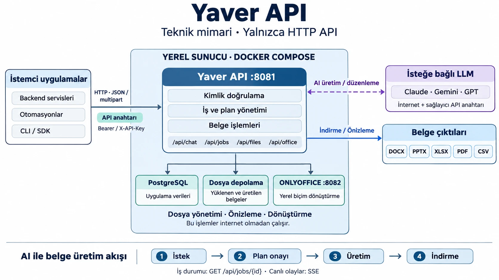

# Yaver API (Office Manipulator — yalnızca API sürümü)

Yaver'in web arayüzü olmayan, **yalnızca HTTP API ile çalışan** sürümüdür. Docker ile kurulur; kurulumdan sonra başka uygulamalar API anahtarıyla bağlanıp belge üretir (DOCX, PPTX, XLSX, PDF, CSV, …), düzenler, dönüştürür ve indirir. Dosya saklama, önizleme ve biçim dönüştürme (ONLYOFFICE ile) **tamamen yerel** çalışır. AI ile üretim (Claude, Gemini veya GPT) isteğe bağlıdır ve internet gerektirir; LLM anahtarı girilmediği sürece bu uç noktalar `503` döner, geri kalan her şey etkilenmeden çalışır.



## API ile kullanım

Docker ayağa kalktığında uygulama **yalnızca bir API servisi** olarak çalışır: web arayüzü yoktur; her şey (belge üretme, plan onaylama, düzenleme, dönüştürme, indirme, ayarlar) HTTP API ile yapılır. Böylece başka uygulamalar Yaver'e doğrudan bağlanabilir.

**Kimlik doğrulama:** Her `/api/...` isteği `.env`'deki `YAVER_API_KEYS` anahtarlarından birini taşımalıdır:

```
Authorization: Bearer <anahtar>      # ya da
X-API-Key: <anahtar>
```

Anahtar yoksa ya da yanlışsa yanıt `401` olur. Birden çok anahtarı virgülle ayırarak her bağlanan uygulamaya ayrı anahtar verebilir, birini silerek erişimini kesebilirsiniz.

**Açık (anahtarsız) adresler:**
- `GET /health`: sağlık kontrolü (`{"status":"UP"}`)
- `GET /docs`: Swagger arayüzü; tüm uç noktalar burada denenebilir (sağ üstteki **Authorize** düğmesine anahtarı girin)
- `GET /v3/api-docs`: OpenAPI 3 şeması; istemci kodu üretmek için kullanılabilir

**Tipik akış:**

```bash
B=http://<sunucu>:8081; H="Authorization: Bearer $YAVER_API_KEY"

# 1) LLM anahtarını bir kez kaydedip doğrulayın (ya da .env'e yazın, ya da her istekte llm_api_key gönderin)
curl -X POST $B/api/settings/verify -H "$H" -H 'Content-Type: application/json' \
  -d '{"provider":"gemini","claudeApiKey":"<LLM anahtarı>","model":"gemini-2.5-pro"}'

# 2) İş oluşturun → {"jobId":"…","status":"PENDING"}
curl -X POST $B/api/chat -H "$H" -H 'Content-Type: application/json' \
  -d '{"message":"3 ürün ve fiyatlarından oluşan bir tablo","format":"XLSX"}'

# 3) Durum PLAN_READY olunca planı görün ve onaylayın
curl -H "$H" $B/api/jobs/<jobId>            # status alanını izleyin
curl -H "$H" $B/api/jobs/<jobId>/plan
curl -X POST -H "$H" -H 'Content-Type: application/json' -d '{}' $B/api/jobs/<jobId>/plan/confirm

# 4) İlerlemeyi canlı izleyin (Server-Sent Events) ve DONE olunca indirin
curl -N -H "$H" $B/api/jobs/<jobId>/events
curl -H "$H" -OJ $B/api/files/<jobId>/download
```

**Başlıca uç noktalar** (tam liste ve şemalar `/docs`'ta):

| Uç nokta | İş |
|---|---|
| `POST /api/chat` | Metin isteğinden belge işi oluşturur (`format`: DOCX, PPTX, XLSX, PDF, CSV, …) |
| `POST /api/chat/with-file` | Dosya yükleyerek iş oluşturur (multipart: `message`, `file`). Tek dosya düzenlenir veya dönüştürülür; `file` en fazla 10 kez tekrarlanırsa tüm belgelerden tek yeni belge üretilir ve kaynak rakamların çıktıda yer aldığı kontrol edilir |
| `GET /api/jobs`, `GET /api/jobs/{id}` | İş listesi / tek iş durumu |
| `GET /api/jobs/{id}/events` | Durum değişikliklerini SSE olarak akıtır |
| `GET /api/jobs/{id}/plan`, `POST …/plan/confirm` | Üretim planını görme / onaylama |
| `POST /api/edit` | Tek düzenleme ucu. Belge `jobId` (JSON) ya da yüklenen `file` (multipart). `instruction`: doğal dille düzenleme (şablon korunur; başa/araya/sona sayfa ekleme, konu değiştirme, sunum resimlerini yenileme). `fragment`+`instruction`: tek parça. `content`: içeriği doğrudan güncelleme. Yalnız `format`: başka biçime dönüştürme |
| `POST /api/jobs/{id}/cancel` | İşi iptal etme |
| `POST /api/jobs/{id}/edit`, `…/edit-fragment`, `…/convert`, `PATCH …/content` | Eskiyen yollar: `/api/edit` ile aynı işi yapar; yanıtta `Deprecation`, `Sunset` (1 Haziran 2027) ve `Link` başlıkları döner |
| `GET /api/files/{id}/download`, `…/preview`, `…/preview/images` | İndirme ve önizleme |
| `POST /api/office/import`, `GET\|POST /api/office/text/{jobId}` | Mevcut belgeyi içe aktarma, metnini okuma/yazma |
| `GET\|POST /api/settings`, `POST /api/settings/verify` | LLM sağlayıcı/anahtar ayarları |
| `GET /api/budget` | Harcanan / kalan bütçe |

**Tarayıcıdan çağrı (CORS):** Sunucudan sunucuya çağrılarda bir şey gerekmez. Başka bir alan adındaki web uygulaması tarayıcıdan çağıracaksa o adresi `YAVER_CORS_ORIGINS=https://portal.ornek.com` şeklinde ekleyin; listede olmayan kaynaklardan gelen tarayıcı istekleri `403` alır.

> **Güvenlik:** API anahtarı düz HTTP üzerinden açık metin gider. Uygulamayı internete ya da güvenilmeyen bir ağa açacaksanız önüne HTTPS sonlandıran bir ters vekil (nginx, Caddy, Traefik) koyun ve `.env`'de `API_BIND_ADDRESS=127.0.0.1` yapın. `/internal/...` uç noktaları her durumda yalnızca konteynerin kendisinden erişilebilir.

### İstek başına LLM anahtarı

Kullanıcıya dönük eşzamanlı uç noktalar (`POST /api/chat`, belge düzenleme, `POST /api/office/sessions/{id}/agent`) istek gövdesinde isteğe bağlı `llm_provider`, `llm_api_key`, `llm_model` alanlarını kabul eder; o istek `.env`'deki varsayılan yerine bu anahtarla çalışır ve anahtar saklanmaz. Arka plan ve zamanlanmış işler her zaman `.env` değerlerini kullanır. Sağlayıcı yalnızca `anthropic`, `gemini`, `openai` veya `openai_compatible` olabilir (sonuncusu `.env`'de ya da Ayarlar API'sinde kayıtlı sunucuya gider); istekten adres/uç nokta kabul edilmez.

```bash
curl -X POST http://localhost:8081/api/chat \
  -H "Authorization: Bearer $YAVER_API_KEY" \
  -H 'Content-Type: application/json' \
  -d '{"message": "<isteğiniz>", "format": "DOCX", "llm_provider": "gemini", "llm_api_key": "<anahtarınız>", "llm_model": "gemini-2.5-pro"}'
```

## Model karşılaştırması (benchmark)

Hangi modeli seçeceğinize karar vermeniz için Yaver 10 metin ve 7 görsel modelle, gerçek kullanıcı akışıyla (istek → plan → onay → üretim → doğrulama) test edildi. Tüm modeller tek bir [NanoGPT](https://nano-gpt.com) anahtarıyla, `openai_compatible` sağlayıcısı üzerinden çağrıldı. Puanlama otomatiktir; insan yargısı yoktur. Tarih: 17 Kasım 2026. Her model bir kez koştu; tek koşum olduğu için ±1 görevlik sapma olabilir.

**Görevler:**
1. **CSV:** 25 ürünlük liste.
2. **Word:** 6 bölümlü politika ve bir tablo.
3. **Şablon düzenleme:** Başlığı değiştir. Şablon korunmalı ve en fazla 2 paragraf değişmeli.
4. **Excel:** Formüllü bütçe; en az 12 formül.
5. **PowerPoint:** 6–12 slayt ve konuşmacı notları.
6. **4 belge birleştirme:** docx, pptx ve 2 csv kaynaktan tek rapor. Toplantı kararlarının tarih, sorumlu ve tutarları ile kategori bazında stok toplamları kontrol edilir; olguların en az %90'ı ve doğru toplam stok istenir.

### Metin modelleri

| Model | Başarı | CSV | Word | Şablon düzenleme | Excel | PowerPoint | 4 belge birleştirme | Toplam süre | Maliyet |
|---|---|---|---|---|---|---|---|---|---|
| `openai/gpt-6.1-terra` | **6/6** | ✅ | ✅ | ✅ | ✅ | ✅ | ✅ %100 | 4 dk | $0.21 |
| `z-ai/glm-5.3` | **6/6** | ✅ | ✅ | ✅ | ✅ | ✅ | ✅ %100 | 8 dk | $0.10 |
| `openai/gpt-6-sol` | **6/6** | ✅ | ✅ | ✅ | ✅ | ✅ | ✅ %96 | 4 dk | $0.44 |
| `anthropic/claude-sonnet-5.5` | **6/6** | ✅ | ✅ | ✅ | ✅ | ✅ | ✅ %100 | 10 dk | $1.06 |
| `anthropic/claude-opus-5.5` | **6/6** | ✅ | ✅ | ✅ | ✅ | ✅ | ✅ %100 | 17 dk | $2.92 |
| `moonshotai/kimi-k2.6` | **6/6** | ✅ | ✅ | ✅ | ✅ | ✅ | ✅ %100 | 53 dk | $0.25 |
| `google/gemini-3.1-pro-preview` | **5/6** | ✅ | ⚠️ | ✅ | ✅ | ✅ | ✅ %96 | 12 dk | $1.04 |
| `deepseek/deepseek-v4.1-flash` | **5/6** | ✅ | ✅ | ✅ | ❌ | ✅ | ✅ %100 | 15 dk | $0.05 |
| `google/gemini-3.8-flash` | **4/6** | ✅ | ✅ | ✅ | ⚠️ 503 | ✅ | ⚠️ 503 | 16 dk | $0.41 |
| `qwen/qwen3.8-27b` | **3/6** | ✅ | ✅ | ✅ | ❌ | ❌ | ❌ | 13 dk | $0.11 |

✅ geçti · ⚠️ belge üretildi ama kontrol tutmadı (Gemini 3.1 Pro: 6 bölümden 5'i) · ❌ model 4 denemede çalışan belge üretemedi · ⚠️ 503 NanoGPT'nin Google rotası "All routes failed" döndü. Bu bir model hatası değil. Gemini 3.8 Flash'ın birleştirmesi ilk koşuda %100 geçmişti. Maliyetler NanoGPT fiyatlarıyladır ve sunum incelemesi dahildir.

**Öneri:**
- **Varsayılan / en iyi fiyat-performans:** `openai/gpt-6.1-terra`. Tüm görevleri en hızlı (4 dk) ve ucuz geçti.
- **En ucuz tam başarı:** `z-ai/glm-5.3`. 6/6 görev, $0.10.
- **En yüksek kalite, maliyet önemsizse:** `anthropic/claude-sonnet-5.5`. Opus 5.5 da 6/6 geçti ama yaklaşık 3 kat pahalı ve sonuçta fark yok.
- **Kimi K2.6:** Hepsini geçti ama çok yavaş (birleştirme 24 dk).
- **DeepSeek V4.1 Flash:** Çok ucuz; Excel'de güvenilmez.
- **Yerel/vLLM sınıfı 27B modeller (Qwen3.8-27B):** Yaver için yetersiz. Excel, sunum ve birleştirmede çalışan betik yazamadı. Kendi sunucunuzda en az 70B sınıfı, araç çağırması güçlü bir model kullanın.

### Görsel modelleri

Aynı 3 sunum görseli istemi her modelle üretildi (`IMAGE_API_STYLE=images`, `/images/generations`). Uygulama içinden uçtan uca da denendi: FLUX.3 Klein ile 5 slaytlık sunuma 5 görsel üretildi ve her biri $0.008 olarak bütçeye işlendi.

| Model | Başarı | Süre/görsel | $/görsel | Örnekler (kafe · büyüme grafiği · çalışma masası) | Not |
|---|---|---|---|---|---|
| `blackforestlabs/flux-3/klein/text-to-image` | 3/3 | 6 sn | $0.008 |    | Fiyatına göre çok iyi; gerçekçi fotoğraf ve sade illüstrasyon |
| `qwen-image-2.1/text-to-image` | 3/3 | 9 sn | $0.02 |    | "Yazı yok" dendiği halde bozuk yazı ekledi; grafik istemini kaçırdı |
| `seedream-v4.5` | 3/3 | 16 sn | $0.04 |    | İyi fotoğraf; 3. istemde kulaklık ve bitkiyi atladı |
| `ideogram/v4.5` | 3/3 | 20 sn | $0.06 |    | Temiz, kurumsal illüstrasyon |
| `nano-banana-2` | 3/3 | 24 sn | $0.08 |    | Ayrıntılı ve isteme sadık |
| `gpt-image-1.5` | 3/3 | 15 sn | $0.17 |    | Sunuma en uygun sade kompozisyonlar |
| `nano-banana-pro` | 3/3 | 32 sn | $0.14 |    | En ayrıntılı ve isteme en sadık; en yavaş |

**Öneri:**
- **Ucuz ve hızlı:** FLUX.3 Klein.
- **En iyi kalite:** Nano Banana Pro ya da GPT Image 1.5.
- Sunum görsellerinde yazı istemiyorsanız Qwen-Image'dan kaçının.

### Yeniden çalıştırma

```bash
BENCH_API_KEY=<anahtar> python3 scripts/benchmark.py text  --app http://localhost:8090 --models openai/gpt-6.1-terra,z-ai/glm-5.3
BENCH_API_KEY=<anahtar> python3 scripts/benchmark.py image --models seedream-v4.5,nano-banana-2
```

Uygulamanın `OPENAI_COMPATIBLE_BASE_URL` değeri aynı sağlayıcıyı göstermelidir (varsayılan `BENCH_BASE_URL=https://nano-gpt.com/api/v1`). `--cap` harcama tavanıdır (varsayılan $14). Ham sonuçlar `benchmark-results/` altında JSON olarak durur.

## Gereksinimler

Hedef bilgisayarda yalnızca şunlar kurulu olmalı:

- **Docker Engine** ve **Docker Compose v2**
- Docker servisi çalışır durumda olmalı

Java, Maven, Node.js, npm gibi hiçbir geliştirme aracının kurulu olması gerekmez; hepsi size verilen imajların içindedir.

## Kurulum

Size verilen paket şu dosyaları içermelidir: `app.tar`, `postgres.tar`, `onlyoffice.tar` (hazır Docker imajları), `docker-compose.yml`, `baslat.sh`, `durdur.sh` ve bu `README.md`.

**1) Yapılandırmayı hazırlayın** (bu klasörde `.env` yoksa):

```bash
cp .env.example .env
openssl rand -hex 32
```

Yukarıdaki komutun çıktısını `.env` dosyasında `OFFICE_JWT_SECRET=...` satırına yazın. `DB_PASSWORD=changeme` satırını da kendi belirleyeceğiniz bir parolayla değiştirin. `YAVER_API_KEYS=` satırına da ikinci bir `openssl rand -hex 32` çıktısı yazın; diğer uygulamalar API'ye bu anahtarla bağlanır. `ANTHROPIC_API_KEY` satırını **boş bırakın** (AI özelliği kapalı kalır; dosya yönetimi ve ONLYOFFICE düzenleme bundan etkilenmez). `.env` dosyasını güvenli bir yerde saklayın, kimseyle paylaşmayın. (Size zaten doldurulmuş bir `.env` verildiyse bu adımı atlayın.)

**2) Başlatın:**

```bash
bash baslat.sh
```

Betik sırasıyla: Docker'ın kurulu/çalışır olduğunu, `.env`'in doldurulduğunu kontrol eder → imajları yükler → yapılandırmayı doğrular → servisleri başlatıp sağlıklı olmalarını bekler. İlk açılış birkaç dakika sürebilir. Sorun olursa betik size hangi komutla (`docker compose ... logs`) inceleyeceğinizi gösterir.

Durdurmak için: `bash durdur.sh` (veritabanı ve dosyalar korunur; `bash baslat.sh` ile kaldığı yerden devam eder).

> Betik olmadan elle başlatmak isterseniz: `docker load -i app.tar && docker load -i postgres.tar && docker load -i onlyoffice.tar && docker compose up -d --no-build --pull never && docker compose ps`.

**3) API'ye bağlanın:**

- API: **http://<sunucu>:8081/api/...** (ayrıntılar: [API ile kullanım](#api-ile-kullanım))
- API dokümantasyonu: **http://<sunucu>:8081/docs**
- ONLYOFFICE (uygulama tarafından otomatik kullanılır, doğrudan açmanız gerekmez): **http://localhost:8082**

API ağdaki diğer cihazlardan anahtarla erişilebilir (`API_BIND_ADDRESS`); ONLYOFFICE yalnızca bu bilgisayardan erişilebilir.

## Doğrulama

```bash
docker compose -p office-manipulator-teslim ps
curl -s http://localhost:8081/health
curl -s -H "Authorization: Bearer <YAVER_API_KEYS'teki anahtar>" http://localhost:8081/api/office/capabilities
```

İkinci komut bir JSON yanıtı dönerse uygulama ve ONLYOFFICE entegrasyonu çalışıyor demektir.

## Durdurma ve yeniden başlatma

```bash
bash durdur.sh    # servisleri durdurur, veritabanı/dosyalar korunur
bash baslat.sh    # kaldığı yerden yeniden başlatır
```

Günlükleri incelemek için:

```bash
docker compose -p office-manipulator-teslim logs --tail=100
docker compose -p office-manipulator-teslim logs -f app   # yalnızca uygulama servisini canlı izlemek için
```

> `-p office-manipulator-teslim` bayrağı önemli: bu klasörün adı farklıysa Docker Compose proje adını klasör adından türetir ve `baslat.sh`'ın kullandığı sabit proje adıyla eşleşmeyebilir. `-p office-manipulator-teslim` yazmayı unutursanız komut "boş" görünebilir.

## Yapay zekâ sağlayıcısını bağlama

Yaver dört sağlayıcıyla çalışır: Anthropic, Gemini, OpenAI ve **OpenAI-uyumlu** sunucular (vLLM, Ollama, LM Studio, NanoGPT, OpenRouter…). Hangi modelin seçileceği için yukarıdaki [Model karşılaştırması](#model-karşılaştırması-benchmark) bölümüne bakın.

**API ile** (sunucu adresi ve anahtar yalnızca doğrulama başarılı olursa kaydedilir; anahtar istemeyen sunucu için `EMPTY` yazın):

```bash
curl -X POST $B/api/settings/verify -H "$H" -H 'Content-Type: application/json' \
  -d '{"provider":"openai_compatible","baseUrl":"https://nano-gpt.com/api/v1","claudeApiKey":"<anahtar>","model":"openai/gpt-6.1-terra"}'
```

**`.env` ile** (örnekler):

```bash
# NanoGPT / OpenRouter gibi barındırılan bir API
LLM_PROVIDER=openai_compatible
OPENAI_COMPATIBLE_BASE_URL=https://nano-gpt.com/api/v1
OPENAI_COMPATIBLE_API_KEY=<anahtarınız>
OPENAI_COMPATIBLE_MODEL=openai/gpt-6.1-terra
LLM_INPUT_PRICE_PER_MILLION=1      # modelin fiyatı (USD / 1M token); boşsa maliyet "ücret hesaplanmadı" görünür
LLM_OUTPUT_PRICE_PER_MILLION=5

# Kendi sunucunuzdaki vLLM (araç çağırma açık olmalı)
#   vllm serve <model> --enable-auto-tool-choice --tool-call-parser hermes --max-model-len 32768
LLM_PROVIDER=openai_compatible
OPENAI_COMPATIBLE_BASE_URL=http://192.168.1.50:8000/v1
OPENAI_COMPATIBLE_API_KEY=EMPTY
OPENAI_COMPATIBLE_MODEL=Qwen/Qwen2.5-72B-Instruct
```

**Görsel üretimi** (sunumlara görsel; isteğe bağlı):

```bash
GEMINI_ENABLED=true
IMAGE_OPENAI_COMPATIBLE_BASE_URL=https://nano-gpt.com/api/v1   # anahtar OPENAI_COMPATIBLE_API_KEY'den alınır
IMAGE_API_STYLE=images                                          # /images/generations (FLUX, Seedream, GPT Image…)
GEMINI_IMAGE_MODEL=blackforestlabs/flux-3/klein/text-to-image
IMAGE_PRICE_PER_IMAGE=0.008
```

**Notlar:**
- Kendi sunucunuzda en az 70B sınıfı, araç çağırması güçlü bir model kullanın; 27B sınıfı modeller Excel, sunum ve birleştirmede başarısız oldu.
- Model betik üretemezse kullanıcı yığın izi yerine ne yapacağını söyleyen bir mesaj görür; ayrıntılar uygulama günlüğüne yazılır.

## Kaynaktan çalıştırma ve testler (geliştirici)

**Gerekenler:**
- Java 21 ve Maven
- Node **24** ve `npm`
- PostgreSQL 16
- Belge betiklerini yalıtan `bubblewrap`, `prlimit` ve DejaVu fontları (ayrıntı: [docs/node-sandbox.md](docs/node-sandbox.md))
- ONLYOFFICE yalnızca tarayıcıda düzenleme ve sunum incelemesi için gerekir.

```bash
docker run -d --name om-db -p 127.0.0.1:5432:5432 \
  -e POSTGRES_DB=officemanipulator -e POSTGRES_USER=app -e POSTGRES_PASSWORD=<parola> postgres:16
npm ci --ignore-scripts
mvn -B package                  # testlerle birlikte derler
set -a; . ./.env; set +a        # yukarıdaki sağlayıcı ayarları ve YAVER_API_KEYS
SERVER_PORT=8090 SPRING_DATASOURCE_URL=jdbc:postgresql://localhost:5432/officemanipulator \
SPRING_DATASOURCE_USERNAME=app SPRING_DATASOURCE_PASSWORD=<parola> \
java -jar target/office-manipulator-1.0.0-SNAPSHOT.jar
```

API http://localhost:8090 adresinde açılır (`/docs` Swagger). Veritabanı şeması ilk açılışta Flyway ile kurulur.

**Testler:**
- `mvn -B test` yaklaşık 190 birim/entegrasyon testi çalıştırır ve yapay zekâ çağırmaz.
- Gerçek modellerle uçtan uca karşılaştırma için `scripts/benchmark.py` kullanın (bkz. [Yeniden çalıştırma](#yeniden-çalıştırma)).

**Bu sürümde yapılan ve test edilenler:**
- **OpenAI-uyumlu sağlayıcı:** vLLM, Ollama ve NanoGPT ile gerçek sunucuda denendi. Sunucu adresi `POST /api/settings/verify` ile `baseUrl` alanından girilebiliyor.
- **Şablonu koruyan AI düzenleme:**
  - Küçük değişiklik yalnızca ilgili metni değiştirir; stiller ve şablon korunur (`editMode=TEMPLATE`).
  - Bölüm ekleme gibi yapısal bir değişiklik yeni belge üretir (`NEW_DOCUMENT`); önceki sürüm geçmişte kalır.
- **Birden çok belgeden bilgi kaybı olmadan tek belge:**
  - Kaynaklardaki tarih, isim ve tutarlar kontrol edilir; eksik kalırsa bir kez yeniden yazdırılır.
  - Stok, adet ve bütçe sütunları ile kategori bazında toplamlar uygulama tarafından hesaplanıp modele verilir.
- **Kullanıcı gözüyle test sonrası düzeltmeler:**
  - Hata mesajları anlaşılır hâle getirildi.
- **Görsel üretimi:** `/images/generations` uç noktası destekleniyor; görsel başına ücretlendirme yapılıyor.
- **Model karşılaştırması:** 10 metin ve 7 görsel model ölçüldü.

## Ortam değişkenleri (`.env`)

| Değişken | Açıklama | Ne yapmalısınız |
|---|---|---|
| `DB_PASSWORD` | PostgreSQL parolası | **Zorunlu** — kendi parolanızı belirleyin |
| `YAVER_API_KEYS` | Diğer uygulamaların API'ye bağlanırken kullanacağı anahtar(lar), virgülle ayrılmış, her biri en az 24 karakter | **Zorunlu** — `openssl rand -hex 32` ile üretin |
| `YAVER_CORS_ORIGINS` | Tarayıcıdan API çağırabilecek başka alan adları | Sunucudan sunucuya kullanımda boş bırakın |
| `API_BIND_ADDRESS`, `API_PORT` | API'nin dinlediği arayüz ve port | Varsayılan `0.0.0.0:8081`; önünde HTTPS ters vekil varsa `127.0.0.1` |
| `OFFICE_JWT_SECRET` | ONLYOFFICE ↔ uygulama imzalama anahtarı | **Zorunlu** — `openssl rand -hex 32` ile üretin |
| `LLM_PROVIDER` | Varsayılan yapay zekâ sağlayıcısı: `anthropic`, `gemini`, `openai` veya `openai_compatible` (vLLM, Ollama, LM Studio, Groq, Mistral, DeepSeek, OpenRouter…) | Varsayılan `anthropic`; `POST /api/settings` ile de değiştirilebilir |
| `ANTHROPIC_API_KEY`, `GEMINI_API_KEY`, `OPENAI_API_KEY` | Seçilen sağlayıcının API anahtarı (müşterinin kendi anahtarı; sunucu LLM ücreti ödemez) | Boş bırakın — AI özellikleri kapalı kalır. İnternet erişimi olan bir ortamda `POST /api/settings/verify` ile de girip doğrulayabilirsiniz, `.env`'e yazmak zorunlu değildir |
| `ANTHROPIC_MODEL`, `GEMINI_MODEL`, `OPENAI_MODEL` | Sağlayıcıların varsayılan modeli | Boş bırakılabilir; `GET /api/settings` listesinden seçilip kaydedilir |
| `OPENAI_COMPATIBLE_BASE_URL`, `OPENAI_COMPATIBLE_API_KEY`, `OPENAI_COMPATIBLE_MODEL` | OpenAI-uyumlu sunucu adresi (örn. vLLM `http://vllm:8000/v1`), anahtarı (kimlik doğrulamasız sunucu için `EMPTY`) ve model adı (örn. `Qwen/Qwen2.5-72B-Instruct`). vLLM araç çağırma açık başlatılmalı: `--enable-auto-tool-choice --tool-call-parser …` | Hava boşluklu kurulumda yerel vLLM/Ollama ile AI özellikleri internetsiz çalışır; yerel model maliyeti 0 sayılır |
| `LLM_INPUT_PRICE_PER_MILLION`, `LLM_OUTPUT_PRICE_PER_MILLION` | Varsayılan modelin fiyatı (USD / 1M token), bütçe koruması için | Claude için boş bırakılabilir; Gemini/OpenAI modellerinde ve OpenRouter, Groq gibi ücretli OpenAI-uyumlu servislerde güncel fiyat girilmelidir (girilmezse harcama bütçeye yansımaz) |
| `ANTHROPIC_BASE_URL` | Anthropic API uç noktası | Ayarlamayın (resmî adres kullanılır) — yalnızca kendi barındırdığınız bir Claude-uyumlu uç nokta kullanacaksanız doldurun |
| `MAX_SOURCE_CHARS` | Çok belgeli isteklerde kaynak metnin toplam üst sınırı (karakter; ~4 karakter = 1 token) | Varsayılan `400000`. Aşılırsa istek reddedilir, metin kesilmez. Kendi sunucunuzdaki modelin bağlamından küçük tutun (örn. 32k token'lık vLLM için `80000`) |
| `PRESENTATION_REVIEW_ROUNDS` | Sunumlarda görsel inceleme ve düzeltme turu sayısı | Varsayılan `2`; `0` kapatır (her tur bir inceleme + bir yeniden üretim çağrısı demektir) |
| `PRESENTATION_REVIEW_MODEL` | Slayt incelemesini yapan ayrı görsel model (aynı sağlayıcı ve anahtar) | Boş = üretici model inceler. Görsel okuyamayan üreticiyle (örn. `openai/gpt-oss-120b`) bir görsel model verin, örn. `google/gemma-4-31b-it`; üretici düzeltmeleri yalnızca metin olarak alır |
| `PRESENTATION_REVIEW_INPUT_PRICE_PER_MILLION` / `..._OUTPUT_...` | İnceleme modelinin 1M token fiyatı (USD) | Barındırılan servislerde girin, yoksa harcama bütçeye yansımaz; yerel modelde `0` |
| `FILE_TTL_HOURS` | Üretilen/yüklenen dosyaların ne kadar süre saklanacağı | Varsayılan `72` (saat); ihtiyaca göre değiştirebilirsiniz |
| `BUDGET_LIMIT_USD` | AI çağrıları için bütçe tavanı | AI kapalıyken etkisizdir, değiştirmenize gerek yok |
| `GEMINI_ENABLED`, `GEMINI_IMAGE_MODEL`, `GEMINI_INPUT/OUTPUT_PRICE_PER_MILLION` | Opsiyonel AI görsel üretimi (`GEMINI_API_KEY`'i kullanır; fiyat girilmeden çalışmaz) | `false` bırakın |
| `IMAGE_OPENAI_COMPATIBLE_BASE_URL` | Görselleri Google Gemini API yerine OpenAI-uyumlu bir uç noktadan üretir (örn. OpenRouter: `https://openrouter.ai/api/v1`, `GEMINI_IMAGE_MODEL=google/gemini-2.5-flash-image`) | Boş = Google Gemini API. Doluysa `GEMINI_API_KEY` boş bırakılabilir, `OPENAI_COMPATIBLE_API_KEY` kullanılır |
| `IMAGE_API_STYLE` | `chat` = chat/completions ile görsel (Gemini görsel modelleri); `images` = `/images/generations` (FLUX, Seedream, GPT Image, Ideogram…; örn. NanoGPT `https://nano-gpt.com/api/v1`) | `chat` |
| `IMAGE_PRICE_PER_IMAGE` | `images` stilinde görsel başına USD fiyatı; bütçe bununla takip edilir | `0` (= görsel üretimi kapalı) |

AI kapalıyken (anahtar boşken) model ve fiyat satırları etkisizdir; dokunmanıza gerek yoktur.

## Sınırlamalar

- AI özellikleri (AI ile belge/sunum üretimi ve düzenleme) internet gerektirir ve seçilen sağlayıcının anahtarı boşken kapalıdır — bu beklenen bir durumdur, hata değildir.
- Dosya yükleme/indirme, önizleme, biçim dönüştürme ve ONLYOFFICE ile biçim dönüştürme internet olmadan da tam çalışır.
- Port `8081` veya `8082` başka bir uygulama/konteyner tarafından kullanılıyorsa, `docker-compose.yml` içindeki ilgili `ports:` ayarını (API için `.env`'deki `API_PORT`) değiştirip `bash baslat.sh`'ı tekrar çalıştırın.

## Sorun giderme

- `bash baslat.sh` "port is already allocated" hatası verirse: önce bu bilgisayarda başka bir Docker Compose projesinin aynı portu kullanmadığından emin olun — `docker ps --format "table {{.Names}}\t{{.Ports}}"` ile tüm çalışan konteynerleri listeleyip 8081/8082'yi kimin tuttuğunu görün. Eski/yarım kalmış bir proje varsa `docker compose -p <proje-adı> down` ile kapatın.
- Hata devam ediyor ama `docker ps` hiçbir şeyin o portu kullanmadığını gösteriyorsa: Docker'ın kendi port kayıt tablosu bozulmuş olabilir (özellikle bir konteyner zorla sonlandırıldıysa). `sudo systemctl restart docker` ile Docker servisini yeniden başlatmak genelde bunu çözer — bu, bu bilgisayardaki diğer tüm konteynerleri de kısaca durdurup (varsa) yeniden başlatır.
- `docker compose -p office-manipulator-teslim ps` çıktısında bir servis `unhealthy`/`exited` görünüyorsa: `docker compose -p office-manipulator-teslim logs <servis-adı>` ile ayrıntıyı inceleyin.
- `.env` dosyasında `DB_PASSWORD` veya `OFFICE_JWT_SECRET` boşsa `baslat.sh` bunu başlamadan önce fark edip net bir hata mesajıyla durur — ilgili alanı doldurup tekrar deneyin.
- Docker soketine erişim izni hatası alırsanız komutları `sudo` ile çalıştırmayı deneyin veya kullanıcınızı `docker` grubuna ekleyin.

---

Bu paketi hazırlayan/güncelleyen kişi için mimari, paketleme adımları ve test kaydı dahil kapsamlı dokümantasyon: **[docs/paketleme-ve-teslim.md](docs/paketleme-ve-teslim.md)**.
